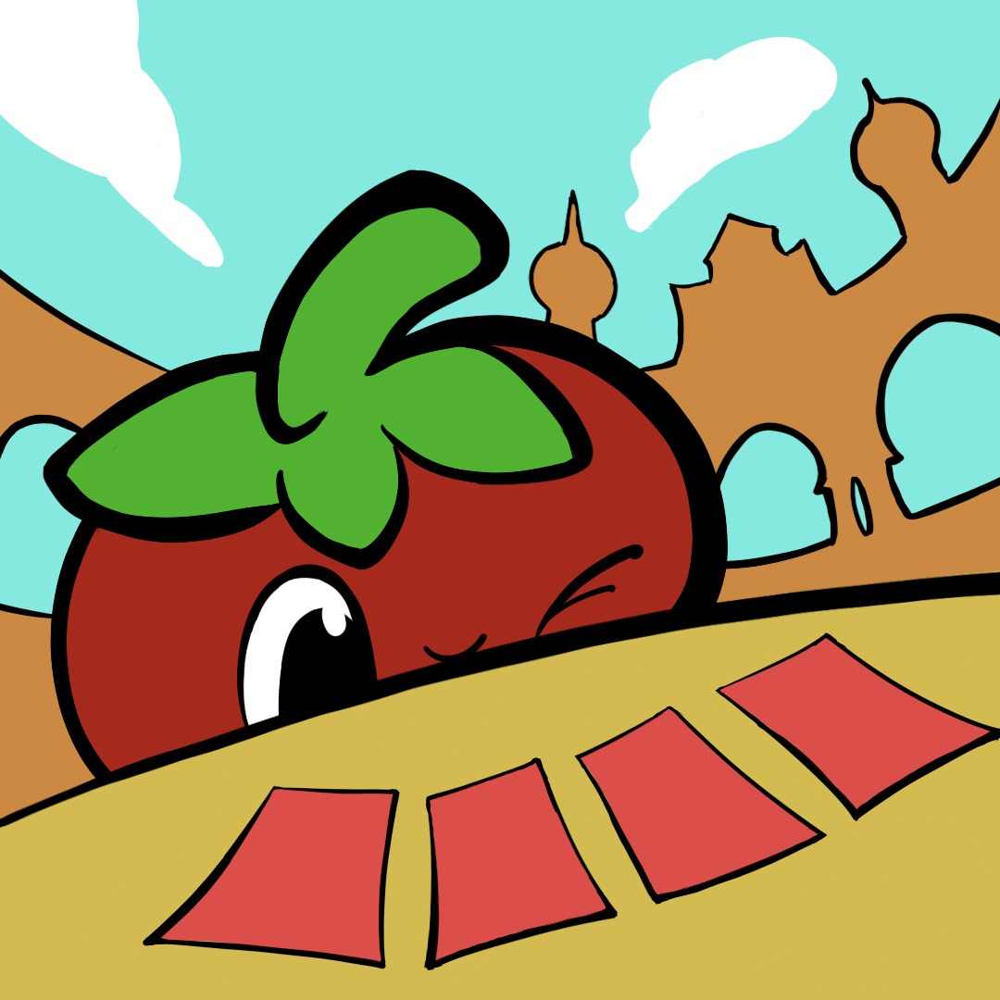
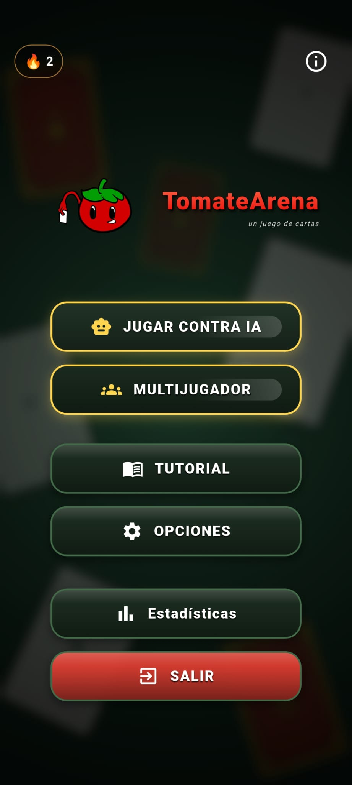
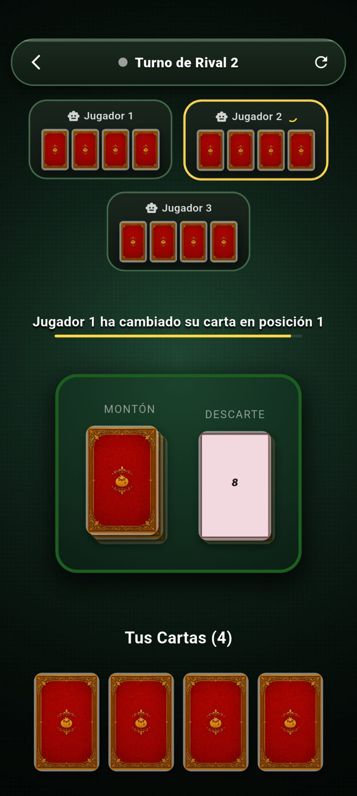

# 🍅 TomateArena — Engine / Backend

  

## 📌 Descripción

Este repositorio contiene la arquitectura de **motor y backend** (*engine*) para el juego **TomateArena**. 

> [!NOTE]
> **Aviso importante:** El repositorio principal de *TomateArena* no es público en este momento, ya que el proyecto se encuentra en fase de revisiones internas y pruebas.

Esta versión publicada únicamente incluye el **código fuente del motor del juego**:
- **NO** incluye la interfaz gráfica de usuario (GUI/UI).
- **NO** representa la totalidad del proyecto final.
- Está orientada a mostrar la lógica central, mecánicas de backend y arquitectura base.

---

## 🖼️ Capturas de Pantalla

| Vista General del Juego | Interfaz / Gameplay |
| :---: | :---: |
|  |  |

**Nota**: las capturas de pantalla mostradas pueden estar sujetas a modificaciones con respecto la versión final.

---

## 📄 Licencia

Este proyecto se distribuye bajo la licencia **GNU General Public License v3.0 (GPLv3)**. 

Cualquier persona es libre de usar, modificar y redistribuir este código, siempre que mantenga la misma licencia y libere el código fuente de las modificaciones o trabajos derivados. Consulta el archivo [LICENSE](LICENSE) para conocer todos los detalles.